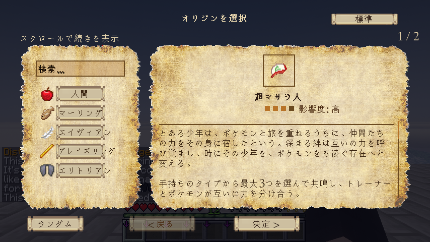
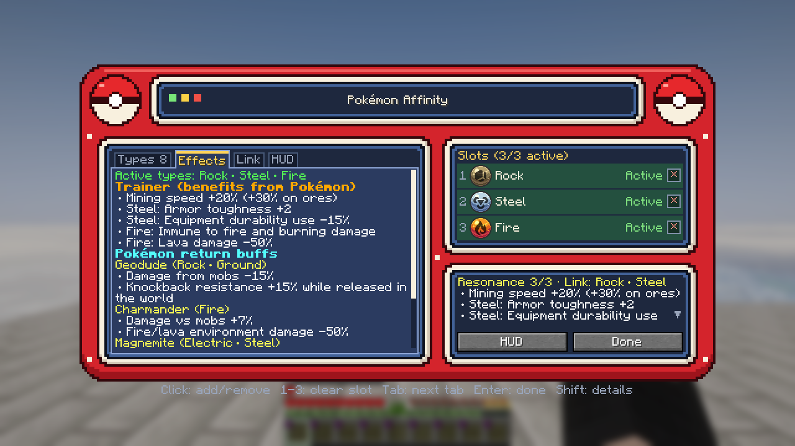
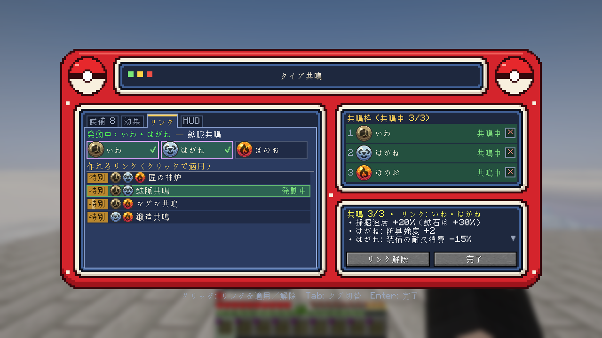
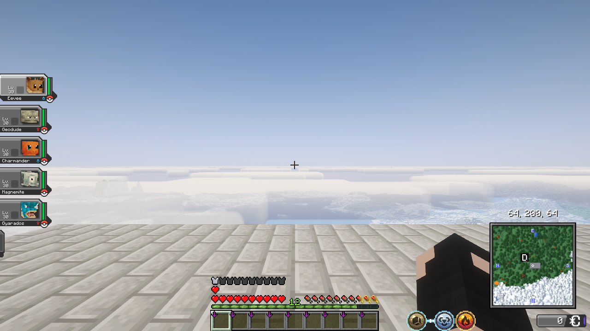

# Super Pallet Towner (超マサラ人)

**A Cobblemon add-on.** Pick up to three types from your party Pokémon, and you and your Pokémon share their power.

- **Cobblemon only:** every player gets the abilities below. NeoOrigins is not needed.
- **With NeoOrigins (NeoForge):** it becomes the Super Pallet Towner Origin, replacing NeoOrigins' Monster Tamer. Players who choose it get the abilities.
- **Fabric:** a Fabric edition is available too. It works like the NeoForge edition without NeoOrigins: every player gets the abilities.

Minecraft 1.21.1 / NeoForge or Fabric · Version 1.3.3 · [日本語の説明はこちら](README_JA.md)

## Abilities

| Ability | What it does |
|---|---|
| **Type Resonance** | Choose up to three types from your conscious party Pokémon. Each type gives you its own bonus, such as movement, attack speed, mining, armor, or immunity to fire. |
| **Pokémon's Return Gift** | Party Pokémon of a chosen type get a bonus too, mainly against Minecraft mobs. Normal Pokémon battles are generally unaffected. |
| **Resonance Links and Harmonics** | Link two or three chosen types for a combination effect. There are 24 named links; any other pair still gives a smaller standard bonus. |
| **Trainer's Talent** | Catch rate +3%. |
| **When the Party Falls** | If your whole party faints, you return to a safe respawn point and your party is healed. It does not trigger with an empty party. |

All bonuses have caps, so the Origin stays balanced with other mods.

## Pokémon Affinity screen

Open it with the **Open Pokémon Affinity** key (**Y** by default; change it in Controls). Choose the types, check every effect, and link types.

### Keys (default settings)

| Key | What it does |
|---|---|
| **Y** | Opens the Pokémon Affinity screen. Shown in Controls as **Open Pokémon Affinity** under **Super Pallet Towner**. |

Y is not used by Minecraft, Cobblemon or NeoOrigins. Some other add-ons may use it too (for example, Cobblemon Raid Dens uses Y to accept a raid). If a key is shared, Controls shows it in red; give one of them another key there. Before 1.2.0 this key was unassigned; players who already set a key keep theirs.

Inside the Pokémon Affinity screen:

| Key | What it does |
|---|---|
| Click | Add or remove a type (on the Link tab: apply or clear a link) |
| 1 – 3 | Clear that resonance slot (not on the HUD tab) |
| Tab | Next tab (Shift + Tab: previous tab) |
| Enter | Done (close the screen); keypad Enter works too |
| Shift (hold) | Full details of the type under the cursor (return gifts, conditions) |
| Esc | Close the screen |

### Named links

| Pair | Link | Trio | Harmonic |
|---|---|---|---|
| Rock + Steel | Ore Vein | Fire + Rock + Steel | Master Forge |
| Fire + Steel | Forge Link | Ice + Rock + Ground | Absolute Bastion |
| Fire + Rock | Magma Link | Dragon + Fire + Flying | Dragonfire Glide |
| Water + Grass | Biosphere | Fairy + Grass + Water | Life Bloom |
| Ice + Water | Permafrost | Dark + Ghost + Psychic | Void Mind |
| Bug + Grass | Bio-Harvest | Fairy + Light + Psychic \* | Sacred Harmony |
| Electric + Steel | Electromagnetic | Air + Electric + Flying \* | Tempest Drive |
| Dark + Ghost | Abyss Stalker | Electric + Sound + Steel \* | Resonance Engine |
| Dragon + Fighting | Apex Might | | |
| Psychic + Fairy | Mystic Aegis | | |
| Normal + Fighting | Inner Force | | |
| Air + Flying \* | Jetstream | | |
| Air + Electric \* | Thundercloud | | |
| Fairy + Light \* | Radiance | | |
| Electric + Sound \* | Amplifier | | |
| Sound + Steel \* | Resonant Metal | | |

\* Air, Light and Sound are types added by other Cobblemon mods. These links only appear if such a mod is installed.

## Icon

The Origin uses its own icon, the **Trainer Emblem**: a capture ball wearing a red-and-white cap. You can also get it as an item with `/give @s super_pallet_towner:trainer_emblem`.

## HUD

A small HUD shows your active types and links. Move and resize it on the **HUD** tab of the Pokémon Affinity screen (with NeoOrigins, also from its HUD editor). New types pop in, a ring bursts when a link activates, and light flows along the links. You can turn the animations off in the client config (`hudAnimations`) or, with NeoOrigins, in the HUD editor.

## Requirements

Install on both client and server. Use the Jar for your loader.

| | NeoForge edition | Fabric edition |
|---|---|---|
| Jar | `super_pallet_towner-neoforge-1.3.3.jar` | `super_pallet_towner-fabric-1.3.3.jar` |
| Loader (Minecraft 1.21.1) | NeoForge 21.1.251 or newer 21.1.x | Fabric Loader 0.17.2 or newer + Fabric API 0.116.6 or newer |
| Cobblemon | 1.8.1 – 1.8.4 (NeoForge) | 1.8.1 – 1.8.4 (Fabric) |
| NeoOrigins | optional, 2.2.29 – 2.2.32 | not available |

On NeoForge, Kotlin for Forge is required by Cobblemon. If you install NeoOrigins, it must be one of the tested versions above, because this add-on replaces its main Origin list.

## Installation

1. Back up your world.
2. Download the Jar for your loader (`super_pallet_towner-neoforge-1.3.3.jar` or `super_pallet_towner-fabric-1.3.3.jar`) from [Releases](https://github.com/ghasindusk/SuperPalletTowner-Standalone/releases) and put it in `mods`.
3. Press **Y** (Open Pokémon Affinity) to choose your types. You can change the key in Controls.
4. With NeoOrigins only: choose **Super Pallet Towner** on the Origin screen. Players who chose Monster Tamer are moved to Super Pallet Towner automatically.

### Without NeoOrigins (and on Fabric)

Every player is a Super Pallet Towner. To switch the add-on off for everyone, set `allPlayersWithoutNeoOrigins = false` in `config/super_pallet_towner-common.toml`. One ability depends on NeoOrigins and does nothing without it: the Psychic type's shorter Origin power cooldowns.

On Fabric the HUD is drawn after the vanilla HUD rather than just above the hotbar.

### With NeoOrigins

The Origin data is inside the Jar, so no separate data pack is needed. This add-on replaces NeoOrigins' main Origin list to swap out Monster Tamer. Other add-ons that replace the same list may conflict.

## Status

- Automated tests: 168 passed (including a check that only the NeoOrigins bridge classes refer to NeoOrigins). The release script also checks that the Fabric Jar refers to no NeoForge or NeoOrigins class.
- Checked in game: the Origin screen, the Pokémon Affinity screen and the HUD.
- 1.2.0 without NeoOrigins (NeoForge, Cobblemon, Kotlin for Forge only): the dedicated server starts and stops with no errors, and in game the Pokémon Affinity screen opens, resonance slots become active and the HUD shows.
- 1.2.0 with NeoOrigins 2.2.30: the dedicated server starts with no errors and loads the Origin.
- Tested on a dedicated server (the server crash from versions before 1.1.1 remains fixed).
- 1.3.3 with Cobblemon 1.8.4 and NeoOrigins 2.2.32: dedicated servers start on Fabric and NeoForge (with and without NeoOrigins) with no errors from this mod. In game, a player who already had the Origin and saved types gets their resonance effects on joining: Steel and Rock on NeoForge with NeoOrigins, Normal on Fabric. 1.3.2 does not start with NeoOrigins 2.2.32.
- 1.3.1 with Cobblemon 1.8.3: dedicated servers start on Fabric and NeoForge (with and without NeoOrigins) exactly as with 1.8.2. In game on both loaders: the Pokémon Affinity screen opens with Y, saved types stay active, and Fire blocks fire damage; on Fabric also Normal's movement speed, Fairy's shorter Poison and the type-icon halo in Cobblemon's summary screen.
- 1.3.0 Fabric (Fabric Loader 0.17.2, Fabric API 0.116.7, Cobblemon 1.8.2): the dedicated server starts with no errors from this mod. In game: the Pokémon Affinity screen opens with Y, resonance slots become active, the HUD shows, the chosen types are kept after leaving and rejoining, Normal raises movement speed, Fire blocks fire damage, and Fairy shortens Poison.
- 1.3.0 NeoForge: the dedicated server starts with and without NeoOrigins exactly as 1.2.0 did.
- Not yet tested with other add-ons that replace the NeoOrigins Origin list.

Please report problems in [Issues](https://github.com/ghasindusk/SuperPalletTowner-Standalone/issues).

## Building

Requires Java 21. The source has three parts: `common` (shared code, compiled against plain Minecraft so no loader API can slip in), `neoforge` and `fabric`.

1. Put the NeoForge Cobblemon 1.8.4 and NeoOrigins 2.2.32 Jars in `libs/`, and the Fabric Cobblemon 1.8.4 Jar in `downloads_cobblemon_1.8.4/` (the version is `cobblemon_version` in `gradle.properties`) (used only to compile; nothing is bundled, and NeoOrigins stays optional at runtime).
2. Run `gradlew build`. The Jars are written to `neoforge/build/libs/` and `fabric/build/libs/`.

## Support

If you enjoy Super Pallet Towner, you can support its development on [Ko-fi](https://ko-fi.com/ghasindusk). It is entirely optional; the mod stays free.

## License

MIT. This is an unofficial fan project, not endorsed by the developers of Cobblemon or NeoOrigins. No assets from those mods are included; see [THIRD_PARTY.md](THIRD_PARTY.md).
